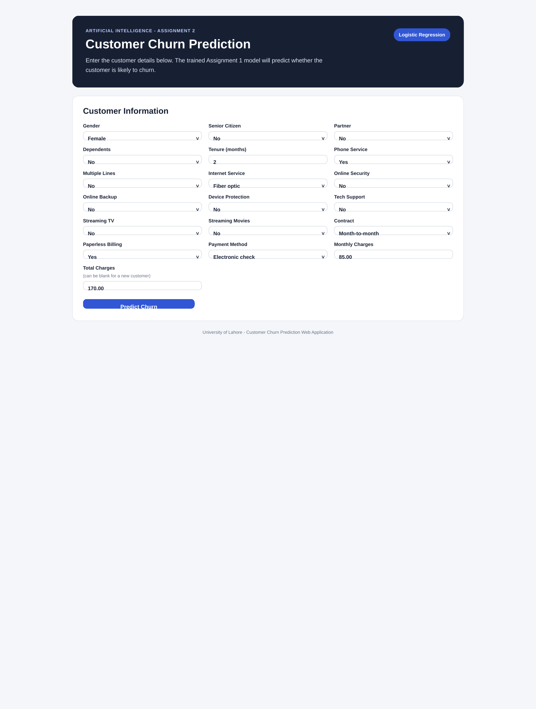
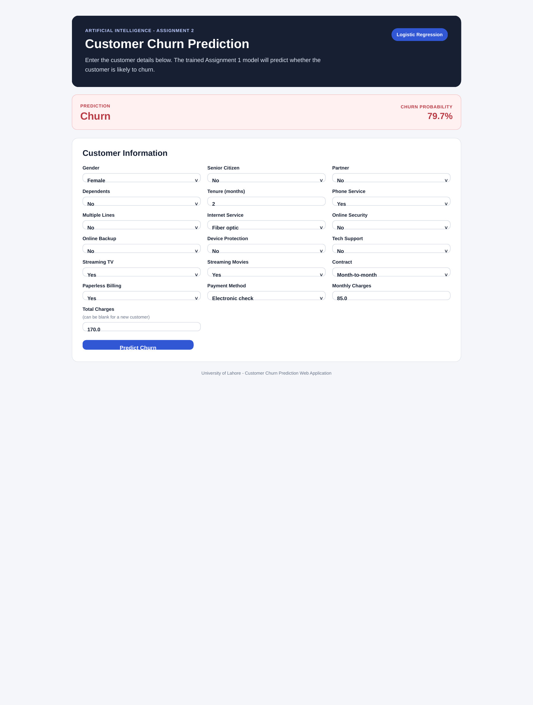
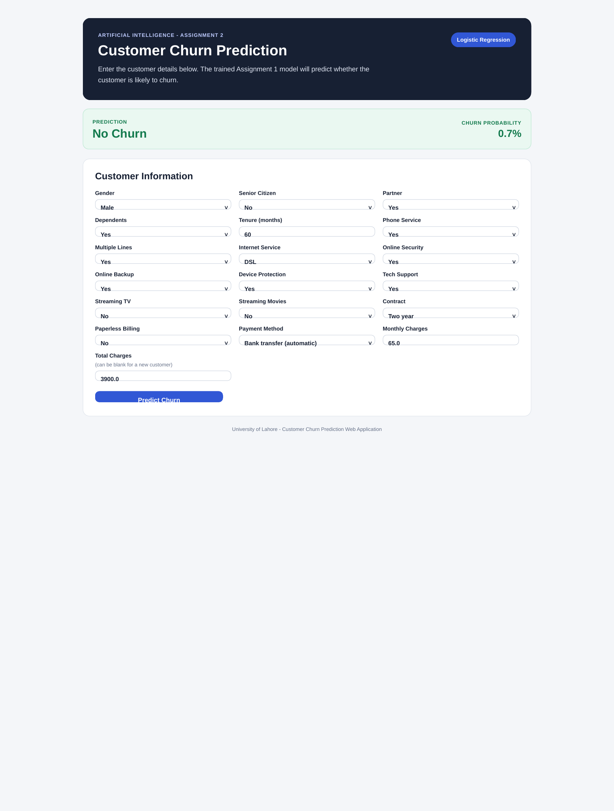
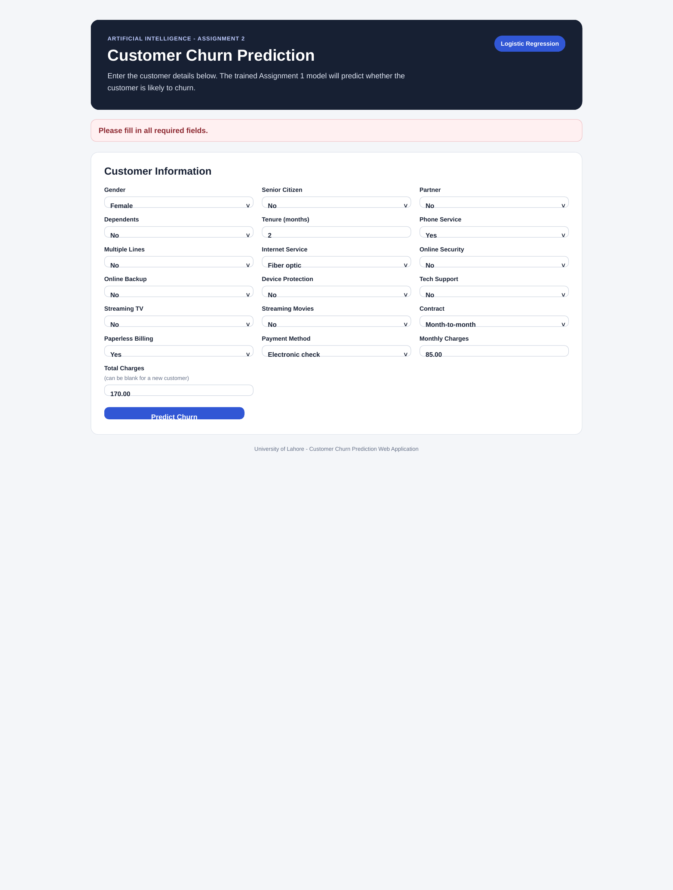

# Customer Churn Prediction Web Application

Artificial Intelligence - Assignment 2  
University of Lahore, Faculty of Information Technology

This project continues Assignment 1 by converting the trained customer churn machine-learning model into a Flask web application. The application accepts telecom customer information, applies the same preprocessing pipeline used during model training, and predicts **Churn** or **No Churn**.

## Student
- **Name:** Abdullah Zahid
- **SAP ID:** 70172820
- **Section:** 5-G

## Model
The project uses the Logistic Regression pipeline selected in Assignment 1. The saved pipeline contains the preprocessing and classifier so the same feature handling is used for both training and web predictions.

Assignment 1 test results:
- Accuracy: 80.55%
- Precision: 65.72%
- Recall: 55.88%
- F1-score: 60.40%
- ROC-AUC: 84.19%

## Project Structure
```text
AI-Assignment-2-Customer-Churn-Flask/
├── app.py
├── predictor.py
├── train_model.py
├── local_test.py
├── model.joblib
├── model_metadata.json
├── requirements.txt
├── templates/
│   └── index.html
├── static/
│   └── style.css
├── data/
│   └── WA_Fn-UseC_-Telco-Customer-Churn.csv
├── deployment/
│   └── pythonanywhere_wsgi.py.example
└── docs/
    ├── Assignment_2_Report.pdf
    └── screenshots/
```

## Run Locally
1. Clone or download this repository.
2. Open a terminal in the project folder.
3. Create and activate a virtual environment.
4. Install the required packages:

```bash
pip install -r requirements.txt
```

5. Start the Flask application:

```bash
python app.py
```

6. Open this address in a browser:

```text
http://127.0.0.1:5000
```

## Test the Saved Model
Run:

```bash
python local_test.py
```

The included test file checks one expected churn customer and one expected no-churn customer.

## Rebuild the Model
The model can be rebuilt from the included Assignment 1 dataset by running:

```bash
python train_model.py
```

## Screenshots
### Web Interface


### Churn Prediction


### No Churn Prediction


### Input Validation


## PythonAnywhere Deployment
The `deployment/pythonanywhere_wsgi.py.example` file contains an example WSGI setup. Replace `YOUR_USERNAME` with the actual PythonAnywhere username and configure the virtual environment in the PythonAnywhere Web tab.

The final live URL should be added here after the application is deployed.

## Main Files
- `app.py` - Flask routes and form handling
- `predictor.py` - validation, feature formatting, and prediction logic
- `model.joblib` - saved machine-learning pipeline from Assignment 1
- `model_metadata.json` - model metrics and feature order
- `templates/index.html` - HTML interface
- `static/style.css` - website styling
- `train_model.py` - model training and saving script
- `local_test.py` - simple prediction tests
- `requirements.txt` - Python dependencies

## Note
Predictions are produced by the saved machine-learning model. They are not hard-coded in the Flask application.
